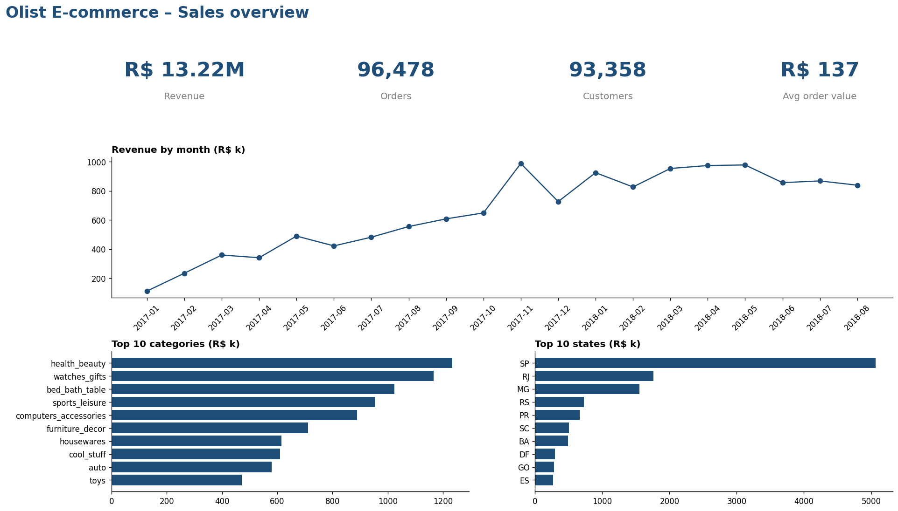
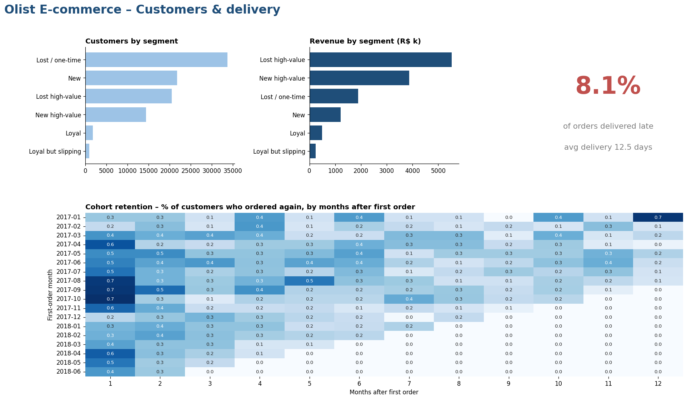

# E-commerce Customer & Sales Analytics (Olist)

**Question:** What sells, where, who are our best customers – and do they come back?

**Data:** [Brazilian E-Commerce Public Dataset by Olist](https://www.kaggle.com/datasets/olistbr/brazilian-ecommerce) (Kaggle) – 8 related tables, ~99k orders, Sep 2016 – Oct 2018.

**Tools:** MySQL 8 (joins, CTEs, window functions, views, indexes), Python (Pandas, SQLAlchemy, Seaborn), Power BI



## Key findings

- **96,478 delivered orders** from **93,358 real customers** → **R$ 13.22M** product revenue, average order value **R$ 137**.
- **Revenue grew 141%** (Jan–Aug 2018 vs Jan–Aug 2017). Peak month: **Nov 2017 (Black Friday) R$ 988k, +52% MoM**. Growth flattened from May 2018.
- **Top 10% of customers bring 41.1% of revenue** (top 20% → 56.6%). A top-10% customer spends R$ 582 vs R$ 93 for the rest.
- **Only 3.0% of customers ever order again**; cohort retention is below 0.5% per month – 97% of customers buy once.
- **Lost high-value** customers are 22% of customers but **41.8% of revenue** – the biggest win-back opportunity.
- **São Paulo = 38.3% of revenue**; SP + RJ + MG = 63.3%. Top category **health_beauty (9.3%)**.
- **8.1% of orders arrive late** (avg delivery 12.5 days; up to 26 days in the north). **Late orders average 2.57★ vs 4.29★ on time.**

### Recommendations
1. **Win back "Lost high-value" customers** (20.5k people, 41.8% of revenue) with a personalised voucher for the category they bought before.
2. **Second-order campaign** 2–4 weeks after delivery for "New high-value" customers – turning even 5% of them into repeat buyers would beat the whole current Loyal segment.
3. **Fix delivery in the north / north-east** (AL 23.9% late, MA 19.7% late) – late delivery costs 1.7 review stars, which hurts repeat purchases.

## Dashboard

| Page 1 – Sales overview | Page 2 – Customers & delivery |
|---|---|
|  |  |

More charts: [cohort heatmap](dashboard/cohort_heatmap.png) · [RFM segments](dashboard/rfm_segments.png) · [categories & states](dashboard/categories_states.png) · [late vs reviews](dashboard/late_vs_reviews.png).
Power BI build steps: [dashboard/POWERBI_STEPS.md](dashboard/POWERBI_STEPS.md).

## Power BI dashboard

`dashboard/powerbi/Olist_Ecommerce_Dashboard.pbip` – a Power BI Project (semantic model in TMDL + report in PBIR, so it is readable and diff-able in git).

**Page 1 – Sales Overview:** revenue, orders, customers and AOV cards, month slicer, monthly revenue trend, top 10 categories and top 10 states.  
**Page 2 – Customers & Delivery:** repeat-customer %, late %, delivery days and review cards, RFM segment slicer, % customers / % revenue by segment, review score late vs on time, cohort retention matrix and delivery days by state.  
Model: `Sales` → `RFM` relationship on `customer_unique_id`; DAX measures Revenue, Orders, Customers, Avg Order Value, Late %, Repeat Customer %, % of Revenue.

**Open it:** double-click `Olist_Ecommerce_Dashboard.pbip` (Power BI Desktop) → click **Refresh** on the Home tab to load the data → *File → Save as* `.pbix` if you want a single file.
Data source: sales_clean.csv, rfm_segments.csv, delivery_reviews.csv, cohort_retention.csv (created by the notebooks) in `data/`. If you cloned the repo to a different folder: *Transform data → Edit parameters → DataFolder* → set it to your `data\` folder.

## How I did it

### 1. Load & clean (MySQL)
`notebooks/01_load.ipynb` loads the 8 CSVs into MySQL with dates as `DATETIME` and ID columns as indexable `VARCHAR`,
then runs the checks in [`sql/01_data_checks.sql`](sql/01_data_checks.sql):

| Check | Result |
|---|---|
| Orders by status | 96,478 delivered, 1,107 shipped, 625 canceled, … |
| Duplicate order ids | 0 |
| Delivered but no delivery date | 8 |
| Products with no category | 610 |
| customer_id vs real customers | 99,441 ids → 96,096 real people |

**Cleaning rules:**
1. Only `order_status = 'delivered'` counts as revenue.
2. Revenue = `price` from order_items (product sales); freight is reported separately.
3. Real people are counted with `customer_unique_id`, not `customer_id` (Olist creates a new `customer_id` for every order).
4. Products with no category are shown as `unknown`.

[`sql/02_indexes_and_view.sql`](sql/02_indexes_and_view.sql) adds indexes on all join keys and builds one clean **`sales` view**
(5-table join) so every query starts from the same data.

### 2. SQL analysis
[`sql/analysis.sql`](sql/analysis.sql) – 11 queries, executed in `notebooks/02_sql_analysis.ipynb`:
monthly revenue & AOV, **month-over-month growth with `LAG()`**, top categories with **share of total via `SUM() OVER ()`**,
revenue by state, delivery performance, late vs. review score, **top 3 sellers per state with `RANK() OVER (PARTITION BY …)`**,
repeat-customer rate, payment mix and delivery by state.

### 3. RFM segmentation & cohorts (Python)
`notebooks/03_rfm_cohort.ipynb` – Recency and Monetary scored 1–5 by quintile; Frequency in simple groups (97% bought once,
so quintiles don't work). Six segments: Loyal, Loyal but slipping, New high-value, New, Lost high-value, Lost / one-time.

| Segment | % customers | % revenue |
|---|---|---|
| Lost high-value | 22.0% | **41.8%** |
| New high-value | 15.5% | 29.3% |
| Lost / one-time | 36.2% | 14.3% |
| New | 23.3% | 9.2% |
| Loyal | 1.9% | 3.7% |
| Loyal but slipping | 1.1% | 1.8% |

Monthly cohort table → [heatmap](dashboard/cohort_heatmap.png): month-1 retention averages **0.47%**.

### 4. Dashboard
`notebooks/04_powerbi_export_and_preview.ipynb` exports `data/sales_clean.csv` + `data/rfm_segments.csv` for Power BI and
draws the preview images above.

## Project structure

```
ecommerce-customer-sales-analytics/
├── data/                 # Olist CSVs (not in git – see data/README.md) + exported CSVs
├── sql/
│   ├── 01_data_checks.sql
│   ├── 02_indexes_and_view.sql
│   └── analysis.sql
├── notebooks/
│   ├── db.py                              # MySQL connection from .env
│   ├── 01_load.ipynb
│   ├── 02_sql_analysis.ipynb
│   ├── 03_rfm_cohort.ipynb
│   └── 04_powerbi_export_and_preview.ipynb
├── dashboard/            # charts, dashboard previews, Power BI steps
├── NOTES.md              # every number found
├── .env.example
└── requirements.txt
```

## How to run

1. Install MySQL 8 and Python 3.10+, then `pip install -r requirements.txt`.
2. Download the dataset into `data/` (see [data/README.md](data/README.md)).
3. Copy `.env.example` to `.env` and set your MySQL password.
4. Run the notebooks in order: `01_load` → `02_sql_analysis` → `03_rfm_cohort` → `04_powerbi_export_and_preview`.
